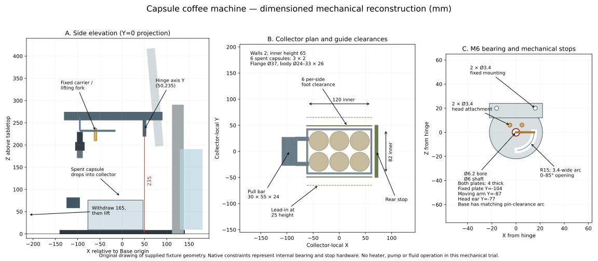

# Empty a capsule coffee machine's collector and load a fresh capsule

This is a capsule coffee machine with a rear water reservoir, coffee outlet, drip grille, hinged loading head and removable used-capsule collector. A used capsule remains in the loading carrier, and six spent capsules are in the collector. Open the head, discharge the spent capsule, remove and empty the collector into the recycling tub, refit it, seat the fresh capsule and close the head. The reference opens the head with the right arm, uses the left arm to slide out, empty and refit the collector by its front bar, and loads the fresh capsule with the left. Scoring accepts other physical solutions.

The revised native demonstration scores **1.0** in **2,332 actions /116.6 simulated seconds**, within the 2,400-action limit. All seven spent capsules are collected, the collector is fitted after release, the fresh capsule is seated, and the loaded head closes to 3.51 degrees. The fixture's complete geometry, source-bound run evidence, seeds and media checks are recorded in `validation/`.

One matching **Dream-1 beta** episode scores **0.0** after **2,400 actions**,
with no runtime error or episode rerun. Its actual three-camera recording has
**2,401 initial/action frames per view**; the full-score demo has **2,333**.

## Motivation and endpoint

[Nespresso's Atelier instructions](https://www.nespresso.com/qa/en/machine-assistance/atelier-machine-assistance), Coffee Preparation and Daily Maintenance, document lifting the lever to eject a capsule, removing and emptying the capsule container, refitting it and loading the next capsule. This task tests physically carrying out that preparation: controlled ejection, handling a loose container full of spent capsules and restoring the loading mechanism. The endpoint is the coffee machine ready for its next capsule, with the fresh capsule seated and its head shut.

The coffee machine uses a passive lifting fork, a hinged head, a removable collector and real-size rigid capsules. It is cold and unpowered during the trial. This familiar capsule-handling operation motivates **Societal relatability**.

## Reproduce the physical machine

[Dimensioned build and assembly instructions](reconstruction/BUILD.md) specify
the collector, carrier, lifting fork,6 mm shaft, bearing bores and 0–85 degree
mechanical stop. [Native-geometry printable models](reconstruction/coffee_machine.scad),
[hinge/stop parts](reconstruction/hinge_kit.scad) and
[physical housing with internal pin-clearance window](reconstruction/physical_housing.scad)
provide an affordable construction route using printed polymer, an ordinary
steel rod, M3 screws, shaft collars and washers. Split housing/lid modules fit
smaller printers. No commercial appliance purchase or one-off manufactured
component is required to reproduce the collector, hinge or ejector.



## Install and run

Use Python 3.12 and the [official Isaac Lab-Arena walkthrough](https://tasks.robocurve.org/walkthrough), with NVIDIA license acceptance configured. Validated package versions and the pinned official YAM adapter are in `SOURCE.json`. From this folder:

```bash
uv pip install --python "$(command -v python)" -e .
python -m pytest -q tests
python check_assets.py --output /tmp/capsule-usd
python check_plan.py
python run.py --policy demo --device cuda:0 --physics-device cpu \
  --width 640 --height 360 --max-steps 2400 --seed 1415158438 \
  --output /tmp/capsule-native
```

Every output directory must be new. `--no-cameras --device cpu` runs development physics without a submission video. `--policy hold`, `open`, `empty` and `reload` stop at progressively later substeps. The revised native reference took 192.6 wall-clock seconds on an RTX PRO 6000 with CPU PhysX and three native 640×360 camera streams, including initialization. Hosted inference adds wall time. The hard limit is 2,400 actions,120 simulated seconds at 20 Hz with 240 Hz physics. The reset is fixed, with zero object jitter. Inspect seed 0 derives direct-run trial seed 1415158438.

Registered evaluation after installing this package:

```bash
instruction=$(python -c 'from capsule_recovery.config import INSTRUCTION; print(INSTRUCTION)')
inspect-robots run --embodiment capsule_recovery --policy capsule_recovery_scripted \
  -E device=cuda:0 -E physics_device=cpu -E object_jitter=0 -E control_hz=20 \
  -E cam_width=640 -E cam_height=360 --instruction "$instruction" \
  --scorer task_score --max-steps 2400 --epochs 1 --seed 0 --store-frames \
  --no-prompt --grader none --no-rerun --no-rerun-save --log-dir /tmp/capsule-inspect
```

For a Dream-1 evaluation, set `DREAM_API_KEY` in the process environment and run one episode:

```bash
inspect-robots run --embodiment capsule_recovery --policy dream \
  -E device=cuda:0 -E physics_device=cpu -E object_jitter=0 -E control_hz=20 \
  -E cam_width=320 -E cam_height=176 \
  -P model=dreamlabs/dream-1-beta -P rows_per_request=48 -P record=false \
  --instruction "$instruction" --scorer task_score --max-steps 2400 --epochs 1 \
  --seed 0 --store-frames --no-prompt --grader none --no-rerun --no-rerun-save \
  --log-dir /tmp/capsule-dream
```

Both videos use the same arrangement: the overview above the left and right
wrist views, at 20 fps H.264/yuv 420 p. The demo records native 640×360 views and
composes 1280×1080(1280×720 overview above two 640×360 wrists). Dream-1 records
native 320×176 views and composes 640×528. All initial/action frames remain in
order at original speed. The setup screenshot is the initial native overview.

The policy reads elapsed time and ordinary measured joint positions. Nominal fixture coordinates and the standard URDF support its taught Cartesian program. Runtime object poses, contacts, scoring state and simulator handles are unavailable to it. All post-reset actuation uses the standard 14 robot controls; task joints remain passive. No runtime attachments, object pose changes, collision changes or software completion events are used. Native traces record robot actions and independent scoring measurements. The light capsules use native PhysX sleeping at a mass-normalized kinetic-energy threshold of 0.0002 m²/s². Unused contact reporting is disabled for every task body at spawn because activating reports sets sleep thresholds to zero; collision response remains enabled. Reset/final diagnostics record the native thresholds, checked after spawning.

## Score

The score uses the current outcome, with permanent invalidation for a dropped part or nonfinite state.

- **0:** fewer than all seven spent capsules are contained at rest in the recycling tub, or any invalidation occurred.
- **0.35:** all seven spent capsules are fully contained at rest in the tub.
- **0.65:** the collection condition holds and the collector is within 9 mm of its fitted pose, with its vertical-axis cosine above 0.99.
- **1:** additionally, the fresh capsule is within 3.5 mm horizontally and 3 mm vertically of its seat, with vertical-axis cosine above 0.99; the head is within 4 degrees of closed; all loose bodies move below 15 mm/s and every pair of observed poses over the preceding second differs by less than 2 mm and 2 degrees; both grippers open over 40 mm; and every robot collision body clears every moving task body by over 3 mm. These conditions persist for one second.

Containment uses transformed mesh/cube vertices and a circumscribed 128-sided envelope for round colliders (under 6 micrometres excess at the capsule flange), with a 0.5 mm contact tolerance, against the tub's inner walls, floor and rim. Merely placing a capsule centre over the tub does not count. A spent capsule must move below 15 mm/s and meet the same one-second pose-stability condition to count. Rest is checked from at least 21 distinct 20 Hz observations spanning a second, with no sample gap over 75 ms. Every pair of poses in that window is compared, so an excursion that returns to its start still fails. This pose-based measurement matches a one-second release video and rejects real translation, rotation and oscillation. Whole-body workspace bounds are x=[-0.19,0.91] m, y=[-0.65,0.65] m and z=[table top-10 mm,2.0] m, audited every physics step. Full robot clearance uses conservative collision-body bounding boxes. Ruler measurements, photos and a one-second release video establish the outcome; no instrumented brewing or pressure measurement is required.

## Setup, construction and reset

World x extends away from the robot bases, +y is the left arm's side, and table top z is 0.7475 m. `config.py` supplies all reset coordinates; `builder.py` defines every original solid, mass and native joint. `check_assets.py` generates the distributable USD assets from source. The adapter supplies the standard two YAM arms, parallel grippers, table, floor, lights and calibrated top/left-wrist/right-wrist cameras.

- Coffee machine: full closed envelope approximately 322×240×290 mm including the reservoir and handle; housing approximately 280×210×290 mm. Nominal polymer housing, metal carrier and lifting fork;2.8 kg anchored base,0.22 kg hinged head. Hinge pivot(0.55,0,0.9825)m,0–85 degree passive range. The bar handle is 240 mm long and 18 mm in diameter. The carrier's capsule-bottom target is(0.44,0,0.957)m. The loaded head closes against the capsule rim, with the explicit 4-degree closed-position allowance.
- Recognizable fixed appliance parts: empty clear-polymer reservoir 50 mm diameter×180 mm high at(0.655,0.040,0.8475)m, dark 54 mm lid and 50 mm foot; metal coffee outlet 12 mm diameter×18 mm at(0.405,0,0.9275)m, on a 20×34×18 mm housing and 12×190×24 mm support bridge; seven metal drip-grille bars 44×4×1 mm at X=0.385 m,Z=0.756 m,Y=-33 to 33 mm at 11 mm pitch. `setup-layout.json` lists every dimension and pose.
- Reconstructible supports:6 mm steel hinge shaft 216 mm long, two 18×12×44 mm moving hinge ears, two 6×6×25 mm fork supports, two 4×176×4 mm carrier beams and two 4×16×8 mm risers. These visibly connect the passive mechanism. Printable bearing/stop hardware and assembly positions are specified in `reconstruction/BUILD.md`.
- Collector: shallow polymer cassette, inner 120×82 mm, 65 mm walls of 2 mm thickness, 65 g; nominal root (0.485,0,0.7575) m. Its inner volume is about 0.64 litres. A 30×55×24 mm front pull bar is centered 95 mm in front of its root and 60 mm above it. Two lateral stems join it to the front wall. Sloped guides have 6 mm side clearance at the foot and a 25 mm lip. The arm withdraws it 165 mm, moves alongside the housing before moving over the recycling tub, and reverses that clear route for reinsertion. It returns 40 mm above the fitted height and then lowers onto the support. The arm opens, withdraws straight out and lifts away.
- Fixed lower housing: a 50×125×130 mm rear service module, two 125×30×105 mm side modules and two 20×30×115 mm carrier pillars. These rectangles remain part of the anchored machine; only the central cassette is removed. Coordinates and materials are listed in `setup-layout.json`, with exact solids in `builder.py`.
- Seven used capsules: nominal aluminium/polymer cups represented by rigid tapered envelopes, 24–33 mm diameter, 26 mm body height, 37 mm diameter and 1.8 mm thick flange, 12 g each. Six start in one 3×2 layer at 39 mm x pitch and 40 mm y pitch, centered at (0.485,0) m; the seventh starts in the loading carrier. Native settling determines their supported starting poses.
- One fresh gold capsule: same cup geometry, 8 g, at (0.56,0.25,0.8175) m on a fixed 70 mm pedestal with an 18 mm top and 50 mm foot diameter.
- Recycling tub: fixed polymer tray, inner 300×300 mm, 55 mm walls, 4 mm wall thickness, nominal floor reference (0.37,0.27,0.7475) m.

Rigid contact and Coulomb friction model clearing, support and closure. The
capsule bodies are convex tapered envelopes. The native revolute joint
represents the internal bearing and mechanical end stops supplied in the
physical construction files. Reset restores all bodies and the head hinge,
opens the arms at READY and settles 1.5 seconds before scoring. No supplies are
consumed. Original geometry, CAD and code are MIT licensed; the manufacturer
link documents the operating procedure and supplies no assets.

Regenerate printable geometry from the task's exact native shapes:

```bash
python check_assets.py --output /tmp/capsule-usd-new
python export_reconstruction.py --assets /tmp/capsule-usd-new --output reconstruction
```

The small physical bearing/stop details in `physical_housing.scad` and
`hinge_kit.scad` implement the internal native joint. Keep those supplied files
and use the complete assembly instructions when building the housing.

## Validation

Eighteen tests cover numeric outcome scoring, invalidation, rest-history
counterexamples and conservative collision geometry. Eleven generated USD
assets pass schema/compliance and joint-target checks. The complete taught
program passes IK, joint limits and the standard 0.04 action-delta guard within
2,400 actions. The fresh revised native reference scores 1.0; a separate
two-step scripted hold verifies the registered Inspect interface and all three
native 320×176 camera streams. This interface check is not a full-score demo.
Validation reports are in `validation/`; source/package pins are in
`SOURCE.json`.
