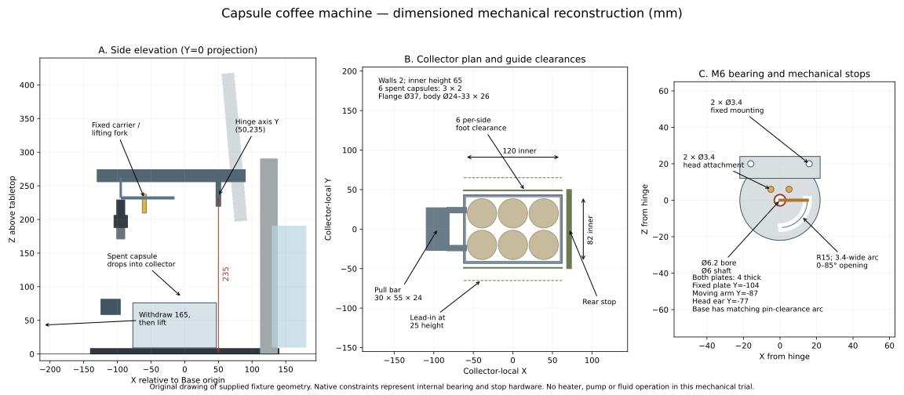

# Build the capsule coffee machine

The supplied OpenSCAD models reproduce the cold capsule coffee machine's
mechanical loading head, lifting fork, fixed carrier, removable collector and
fixtures. Dimensions are in **millimetres**. The models are generated from the
same USD solids and transforms used by the simulator. The hinge bearing and
mechanical end stops, represented by a native revolute joint in simulation,
are supplied as a separate physical hardware kit.



## Models and coordinate frames

- `coffee_machine.scad`: select `Base`, `Head`, `Collector`, `Capsule`,
  `RecyclingTray`, `FreshStand`, `HingeShaft` or `MachineAssembly`.
- `hinge_kit.scad`: select `StopPlate`, `StopArm` or `Spacer`.
- `physical_housing.scad`: select `BasePhysical`, `BaseFrontPhysical` or
  `BaseRearPhysical`. These apply the internal stop-pin clearance window to
  the native Base model. Use these housing parts for the physical build.
- `parts.json`: native primitive list, full transforms, hinge location and
  generated-part inventory.

For example, render and export the printable collector with:

```bash
openscad -o Collector.stl -D 'part="Collector"' coffee_machine.scad
openscad -o Head.stl -D 'part="Head"' coffee_machine.scad
openscad -o StopPlate.stl -D 'part="StopPlate"' hinge_kit.scad
openscad -o Base.stl -D 'part="BasePhysical"' physical_housing.scad
```

`Base` and `Head` share an origin at world **(500,0,747.5) mm**. Their supplied
closed alignment is the assembly alignment: do not independently recenter
them when assembling. The hinge is **(50,0,235) mm** in that common frame,
parallel to Y. Collector and Capsule models use their own local frames.
The collector's reset origin is **(-15,0,10) mm** relative to the Base frame.
The source-native capsule is a solid collision envelope; print it with low
infill or use a reusable empty pod of the stated external dimensions.

For a smaller printer, `BaseFront`/`BaseRear` split Base at X=0, and
`HeadLeft`/`HeadRight` split Head at Y=0. Align the flat cut faces and bond
each fixed pair before mounting. These are manufacturing splits: each joined
pair is rigid throughout a trial. Ordinary rigid adhesive or bolted straps
on the external faces can join the printed pieces; keep all additions clear
of the collector opening, fork, capsule seat and gripper bars.

## Materials and hardware

Use rigid PETG, ABS or polypropylene for the housing, collector, tray and
capsule stand. Use smooth printed or aluminum carrier/fork surfaces; remove
print burrs. A clear rigid bottle approximately **50 mm diameter by 180 mm**
can supply the rear reservoir shell. It stays empty and fixed to its bracket.
The coffee outlet and drip grille are fixed appliance parts.

The core hardware is:

| Item | Specification / quantity |
| --- | --- |
| Hinge shaft | One smooth steel rod, **6 mm diameter,216 mm long** |
| Shaft retainers | Two **6 mm shaft collars**, outside the side panels |
| Bearing holes | **6.2 mm diameter**, through both fixed panels and moving ears |
| Stop plate | Printed or metal, **4 mm thick**, supplied CAD |
| Stop arm | Printed or metal, **4 mm thick**, supplied CAD |
| Stop pin | Smooth **3 mm diameter** pin/shoulder screw spanning the arm and plate |
| Stop mounting | Two M3 screws/nuts through **3.4 mm** holes |
| Arm mounting | Two M3 screws/nuts through **3.4 mm** holes |
| Washers/spacers | M6 washers; supplied **10 mm OD,6.2 mm ID,4 mm** spacers |
| Anchor | Bench clamps or bolts through the fixed base, clear of the mechanism |

Nominal simulated masses are **2.8 kg anchored body**, **220 g head**,
**65 g collector**, **8 g fresh capsule** and **12 g per spent capsule**.
Choose infill to keep the moving parts close to these masses; add fixed
ballast if underweight. The anchored base can use a steel backing plate.
Use one reusable, weighed capsule set for all trials, with no wet grounds or
hot liquid. Cover any exposed ballast and round all gripper-contact edges.

## Hinge and end stops

1. Align the Head ears between the fixed side panels. Insert the 6 mm shaft
   along Y through the common **(50,0,235) mm** hinge line. Install washers
   and shaft collars so the head rotates freely without axial escape.
2. Fit the StopPlate on the **right side (negative Y)**, centred on the hinge
   at **Y=-104 mm** in the Base frame. Its two mounting holes are at
   **X=50±16 mm,Z=255 mm**, and face along Y. Fasten it rigidly to the side
   panel; the native model's bearing/limit constraint represents this hardware.
3. Fit the StopArm just outside the right moving ear, centred on the hinge
   at **Y=-87 mm**. Its two attachment holes are **X=50±5 mm,Z=241 mm** in
   the closed position. The matching drill bores are in the Head model.
4. The stop pin is **15 mm** from the hinge, along +X when closed. Pass it
   through the StopArm eye and the StopPlate's **3.4 mm-wide 85-degree arc**.
   At closed alignment its centre is **(65,*,235) mm**. The pin travels toward
   decreasing Z as the head opens. Retain it on both sides without clamping
   the sliding arc. Small radial clearance gives under 1 degree of stop play.
   The supplied physical housing has a matching **4 mm-wide** clearance arc
   through the right fixed panel so this pin can reach the outer stop plate.
5. Check closed alignment against the zero-degree end of the arc, and the
   open stop at **85 degrees**. The head passes its gravity balance point
   before the open stop, so it rests open after release. No powered fixture,
   spring latch or motor is required. The simulator uses constant joint
   friction 0.30 and viscous damping 0.008 N·m·s/rad; those are native bearing
   parameters. The physical bearing should rotate smoothly under a hand at
   the handle, settle at either gravity stop, and not bind on the panels.

## Fixed carrier and passive ejector

The fixed carrier is at world **(440,0,957) mm**, or **(-60,0,209.5) mm**
relative to Base. Its rim-support arcs have nominal radius **18.4 mm** and
their top lies **235 mm** above the tabletop. Two support beams at
**X=-80 and-40 mm**, **Z=227 mm** in the Base frame join the side bridges.
Their **16 mm-wide** central risers leave the lifting fork's paths clear.

The Head's two lifting tines are **75×5×3 mm**, centred at
**(-55,±19.5,232) mm** in the common closed frame. The front fork crossbar is
**6×41×6 mm**, centred at **(-95,0,234) mm**. Two **6×6×25 mm** supports
connect it to the lid. These are rigidly joined to Head, as in the printable
model. The lower support beams end at Z=229 mm, below the tines' lower
surface at Z=230.5 mm. The central risers occupy Y±8 mm, clear of the tines.

Place a spent capsule on the fork/carrier with its flange supported. Raising
the head lifts the flange out of the fixed carrier. Beyond the balance point
the open-backed fork slopes toward the rear; the capsule slides off and drops
into the collector. This operation uses only gravity and the moving rigid
fork. Check the ejection path with a single dry capsule before filling the
collector. No flap, magnet, hidden attachment or hand removal is needed.

## Collector, guides and reset

The collector has **120×82 mm** clear inner dimensions, **65 mm** walls and
**2 mm** nominal wall thickness. Its front bar is **30×55×24 mm**, centred
at **(-95,0,60) mm** in the collector frame. Two side stems connect the bar
to the front wall. The collector is a single freely removable rigid part.

The two guide profiles are supplied in Base. At the foot they leave **6 mm
clearance per side** outside the collector's 43 mm half-width. The lead-in
widens another 16 mm at the **25 mm-high** lip. The rear stop fixes the seated
longitudinal position. Fit the collector at the stated reset pose; its bottom
rests on the fixed foot. Verify a straight **165 mm forward withdrawal**, a
lift after withdrawal, then reinsertion above the guide lips and lowering
onto the foot. The head remains open during this operation.

Reset six dry spent capsules in a **3×2** layer: X spacing 39 mm, Y spacing 40 mm,
with the seventh in the loading carrier. Put the fresh gold capsule upright
on its stand. Restore the fixed parts using `setup-layout.json` and the setup
image. Set the head closed, collector seated and robot hands at READY/open;
let all parts settle before scoring. No material is consumed by a trial.

The native joint approximates the hidden bearing and stops, while all visible
loading, ejection, collector removal and capsule contact remain physical. The
task is the cold mechanical preparation for the next coffee; the water,
heater and pump do not participate in the trial.
