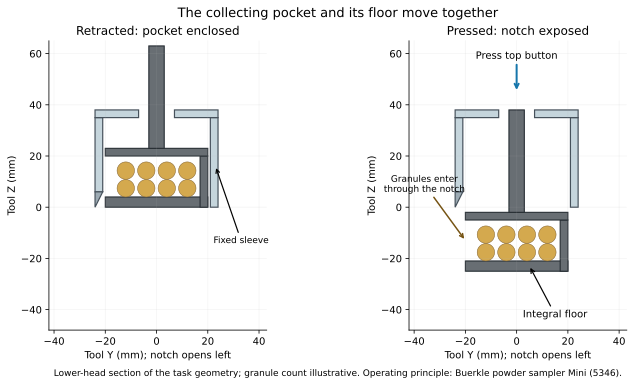

# Collect granules with a sleeve-and-notched-rod sampler

This task follows the operating principle of the [Bürkle powder sampler Mini, 5346 family](https://www.buerkle.de/en/powder-sampler-mini_p5346-3010). The manufacturer describes extending a notched inner rod with a pushbutton, moving gently to fill its collecting notch, retracting the rod into its sleeve, withdrawing the enclosed sample, and extending it again over a collecting vessel.

The reconstruction uses **one moving collecting rod**. Its pocket, solid floor and blue top button are the same rigid part. Pressing the button extends the pocket down from the sleeve; granules enter through the exposed side notch **above** the floor. Releasing the button lets a permanent spring retract and enclose the pocket. Over the jar, the left arm tilts the enclosed tool 20 degrees toward the notch and the right arm presses the button again: the exposed sample rolls/pours out by gravity. There is no suction or transverse discharge plate.

The left gripper holds the barrel below its finger-rest collar; the right gripper presses the ordinary top button with closed fingers. There are no offset control tabs or grasping handles. This is original rectangular geometry inspired by the documented operating principle, not an OEM dimensional replica.

The matching native demonstration scores **1.0**, delivering **6.30 g** (all 35 captured grains) in **2,339 actions / 116.95 seconds**. The pocket is empty, the rod closed and the sampler supported with both hands released. Its source stayed unchanged during the run. The actual-camera video contains all **2,340 initial/action frames per camera**. The earlier hybrid demonstration is superseded. No matching Dream-1 episode, upload or submission has occurred.



## Relevance and category

**Other — laboratory research automation.** Sampling granular feedstocks is preparation work for formulation and materials experiments. This task isolates physically acquiring, enclosing, transporting and discharging a contained subsample. The manufacturer identifies raw-material sampling in pharmaceutical, medical-product and biotechnology settings. The task uses standard clean calibration spheres so repeated trials do not expose shared grippers to loose powder or variable food material.

## Fixed setup

SI units. World +X extends away from the robot bases, +Y toward the left arm; table top z=0.7475 m. The pinned official YAM adapter supplies both calibrated arms, standard parallel grippers, table, floor, lights and three cameras.

- **Outer sampler:** nominal aluminum, polycarbonate inspection panel and rubber-covered barrel; mass 280 g. Lower sleeve 48×48×38 mm, with 42 mm clear square bore; 3 mm walls and an open lower end. A 6 mm chamfer guides coarse beads inward at the notch-facing lower lip during retraction. Hollow 18 mm barrel extends to local z=270 mm. Its ordinary 24×24×80 mm grip is centred at z=180 mm. A 36 mm square, 4 mm thick finger-rest collar is centred at z=194 mm; it has an open centre for the rod. Two square bushings at z=43 and 260 mm guide a 6 mm rod through 6.5 mm holes.
- **Moving collecting rod:** nominal aluminum with polymer button; mass 85 g. The 40×40×23 mm pocket has a **4 mm integral floor**, roof and three surrounding walls; its -Y notch is 34 mm wide, spanning z=4–20 mm. A 6 mm square rod connects the pocket to a 30 mm diameter, 10 mm thick blue pushbutton centred at local z=310 mm. The floor stays underneath the notch during every operation.
- **Passive bearing:** SampleSlide travels 0–25 mm down along local -Z. Its constant spring is 20 N/m, rest point −60 mm, damping 2 N·s/m and joint friction 0.03. Closed preload is 1.2 N; full-stroke spring force 1.7 N. It is a physical bearing/spring, not a switched latch or fixture motor. The measured particle mass adds ordinary gravity load. The right arm presses and releases through normal contact.
- **Source:** fixed polymer tub, 105×105 mm inside, 145 mm walls, 3 mm thick; floor reference (0.40,0.02,0.7475) m.
- **Material:** 1,960 independent native rigid calibration spheres, diameter 6.8 mm and nominal mass 0.18 g each, total 352.8 g. Reset lattice 14×14×10, pitch 7.1 mm, followed by settling. Nominal static/dynamic friction 0.30/0.20; restitution zero. These are dry free-flowing polymer stand-ins.
- **Jar:** fixed polymer cup, 110×110 mm inside, 95 mm walls, 3 mm thick; floor reference (0.22,0.10,0.7475) m. The closed sleeve origin is 50 mm above that reference for discharge. Its exposed pocket remains inside the cup when the tool tilts and the rod extends.
- **Storage:** probe origin (0.28,−0.06,0.7535) m; polymer cradle with 116×116×6 mm foot, 100 mm clear opening and 30 mm walls.
- **Secondary containment:** fixed polymer tray, 520×620 mm inside, 50 mm walls and 8 mm base, centred at (0.40,0.16) m. Material outside the separate jar does not earn delivery credit.

Metal contact friction is nominal 0.35/0.25; the barrel grip uses 1.20/1.00; fixtures 0.65/0.50. These are explicit reconstruction parameters for this apparatus. Every primitive and its size, material colour and body-local position is in scene-inventory.json. setup-layout.json records the fixed layout, masses, calibrated robot/cameras and table. SOURCE.json records package pins, licensing and the direct manufacturer reference.

## Affordable physical reconstruction

The task supplies [printable OpenSCAD union models](reconstruction/sampler.scad) generated from the **same native primitive inventory**. Select `Outer`, `Rod`, `Source`, `Jar`, `Stand`, `Containment` or `granule`; render in OpenSCAD and export STL. For example:

```bash
openscad -o Outer.stl -D 'part="Outer"' reconstruction/sampler.scad
openscad -o Rod.stl -D 'part="Rod"' reconstruction/sampler.scad
```

Model units are millimetres. This provides a custom-tool alternative to buying the commercial instrument. For a low-cost stand-in, use rigid printed PETG/aluminum frame and pocket pieces, a clear 3 mm inspection pane, a rubber/TPU barrel covering, two low-friction square bushings, a 6 mm guide rod and the specified compression spring. Keep the sleeve bore, pocket, opening and stroke dimensions. Remove print burrs and check free sliding over the complete 25 mm stroke. The spring must seat the rod under its loaded weight without the pressing hand. The nominal moving/fixed masses can be matched with small fixed ballast clear of the sample path. The model is a reconstruction drawing; assembly follows the rigid body grouping in builder.py and the supplied dimensions.

For assembly, `reconstruction/assembly_parts.scad` supplies separate `RodCore`, `Button`, `OuterLeft`, `OuterRight`, `StopCollar` and `StrokeSpacer` models. Place the rod and fixed bushings between the outer halves, join the fixed halves, then fit the button after the spring. The native prismatic constraint represents the bearing and its mechanical end stops. In a physical reconstruction, fix the 10×10×4 mm rod collar with its upper face at local z=255 mm, under the upper bushing: this defines the retracted stop. A 10 mm fixed spacer above the z=270 mm barrel end contacts the button underside at z=280 mm after a 25 mm press. The button remains centred at z=310 mm when retracted. Set the spring's installed closed compression to 60 mm; it must return the loaded rod by itself. These small assembly/stop parts are internal bearing details represented by the native joint, not additional manipulation aids.

Use clean hard 6.8 mm calibration spheres, or print and weigh a repeatable batch from the supplied granule model; score the physical trial with a balance. Use the same batch and restore it between trials. The cup, tub and support may be ordinary equivalents with the specified inner dimensions, rigidly fixed at the stated poses. Use a containment tray under the work. All contact with the grippers is against the tool's blunt barrel/button, not sharp edges or raw biological material.

To regenerate CAD after changing geometry:

```bash
python check_assets.py --output /tmp/sampler-assets
python export_reconstruction.py --inventory /tmp/sampler-assets/geometry-inventory.json --output reconstruction
```

## Run and reproduce

Use Python 3.12 and the official Robocurve Isaac Lab-Arena environment, with NVIDIA's licence acceptance configured. From this task folder:

```bash
uv pip install --python "$(command -v python)" -e .
python -m pytest -q tests
python check_assets.py --output /tmp/sampler-assets
python check_plan.py
python run.py --policy demo --device cuda:0 --physics-device cpu \
  --width 640 --height 360 --max-steps 2800 --seed 1415158438 \
  --output /tmp/sampler-native
```

Output directories must be new. Control 20 Hz, native physics 240 Hz; continuous collision detection stays enabled for the granules. Budget: 2,800 actions / 140 seconds. The nominal reference program is 127 seconds. Reset restores geometry and all grains, retracts SampleSlide to zero, initializes READY/open grippers and settles 2.5 seconds. No layout jitter; Inspect seed 0 derives native seed 1415158438. Modes `hold`, `insert`, `open`, `retain` and `deliver` stop at intermediate substeps.

The reference reads elapsed time and ordinary measured robot joints only. Object/grain poses and scores are used exclusively for read-only scoring/auditing. There are no runtime object/particle state writes, spawning/deleting material, motorized fixtures or software latches.

Registered evaluation: `--embodiment slot_sampler --policy slot_sampler_scripted --scorer task_score`, fixed jitter 0, 20 Hz and the instruction in config.py. A hosted evaluation substitutes `--policy dream -P model=dreamlabs/dream-1-beta -P rows_per_request=48 -P record=false`, one epoch without episode reruns. The direct native runner uses the same environment and controller factory.

Demo: three native 640×360 cameras; 1280×1080, 20 fps composite, 1280×720 overview above two 640×360 wrists, left then right. Dream-1: three native 320×176 views and a 640×528 composite. Both use H.264/yuv420p and preserve every initial/action frame in order. Paid hosted evaluation follows successful native validation and user review.

## Numeric score

A grain contributes 0.18 g after it enters the exposed notch from the source, remains wholly inside when the rod retracts to ≤2 mm extension, subsequently leaves through the exposed notch and settles wholly in the jar at <15 mm/s. Merely positioning a filled tool inside the jar earns no delivery. Full-grain entry/exit checks require the grain to be below the sleeve lip, including its radius.

Measurement coordinates follow the moving pocket: +u points out through tool -Y; v is tool X; z follows the rod. The enclosed interior is u∈(−17,20.5) mm, |v|<17 mm, z∈(4,20) mm; membership uses the grain radius with 0.5 mm contact tolerance. Source admission requires upright cosine >0.97, pocket origin within 25 mm of the source reference in X/Y, and between table height and table+55 mm. The jar's inner floor is reference+3.5 mm and its upper bound reference+98.5 mm.

- **0:** less than 2 g eligible settled sample, or permanent invalidation.
- **0.4:** at least 2 g and less than 5 g.
- **0.7:** at least 5 g.
- **1.0:** at least 5 g, plus every corner of the 48×48×38 mm lower sleeve inside the 100 mm cradle opening (+0.5 mm measurement tolerance), origin within 5 mm of support height, upright cosine >0.98, rod extension ≤2 mm, probe speeds <15 mm/s and 0.15 rad/s, both grippers >40 mm open and every robot collision body >3 mm clear, for one second.

Any grain below tabletop−5 mm permanently forces zero. All probe collision bounds must stay within x=[−0.19,0.91] m, y=[−0.65,0.65] m, z=[tabletop−5 mm,2.0 m]. Nonfinite state forces zero. A balance, ruler, camera view of the exposed notch and trial video establish the corresponding physical outcome. Native grain identities implement provenance without changing material. Read-only 240 Hz contact audits additionally report the maximum sphere penetration against the actual pocket floor and sleeve walls; those diagnostics are not policy observations or additional scoring conditions.
